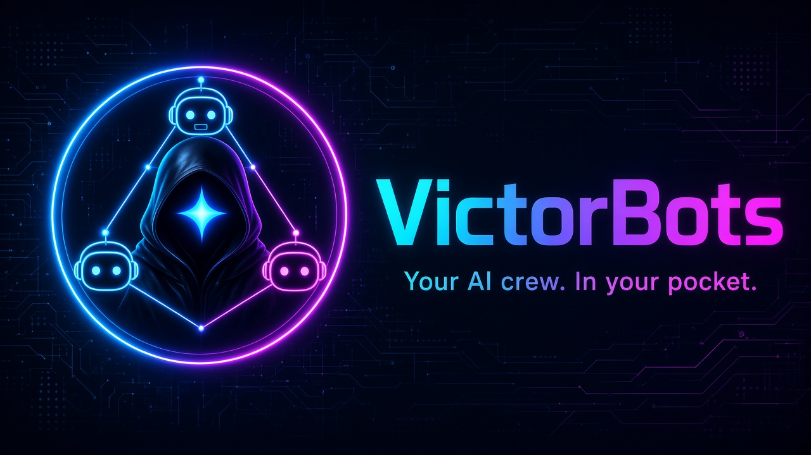
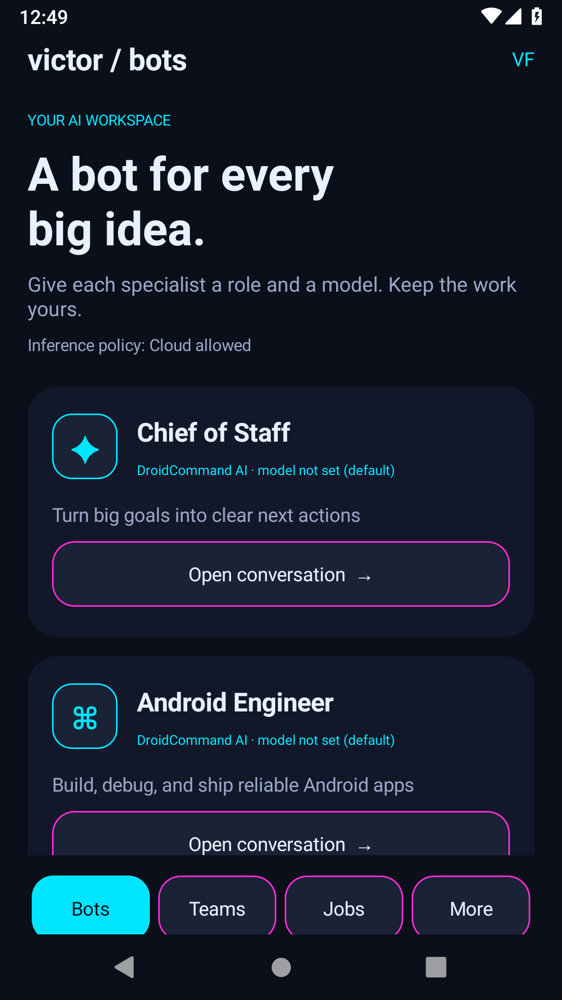
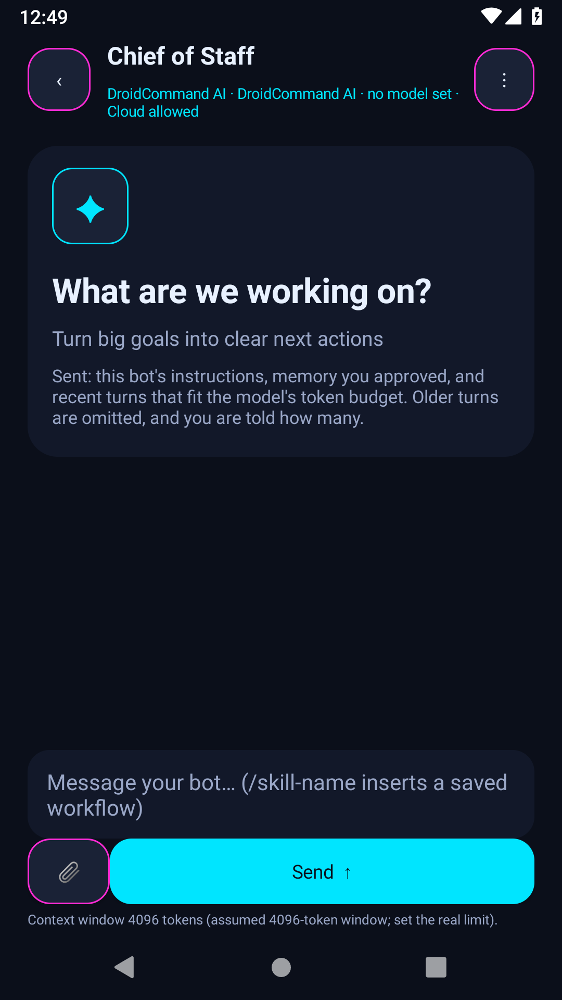
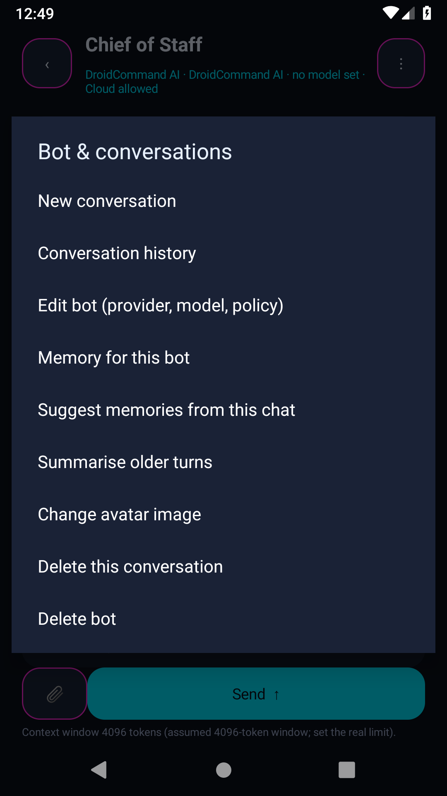
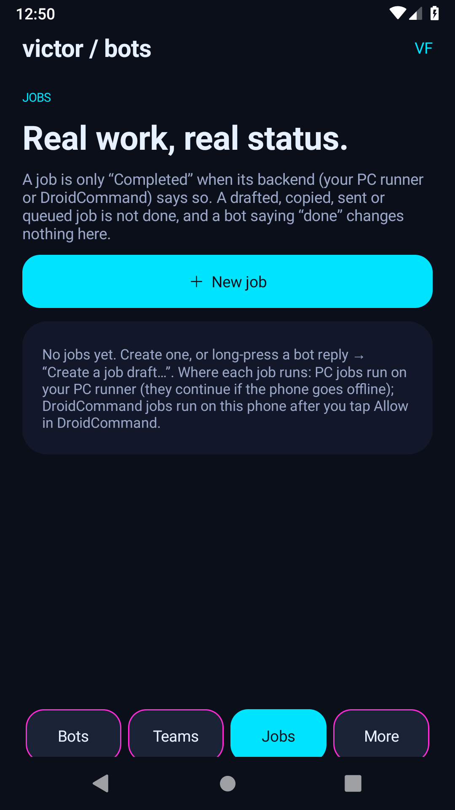
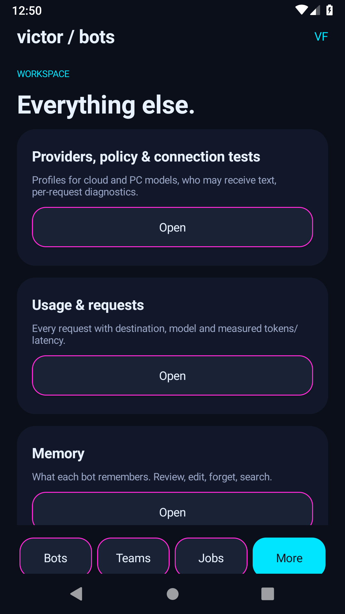
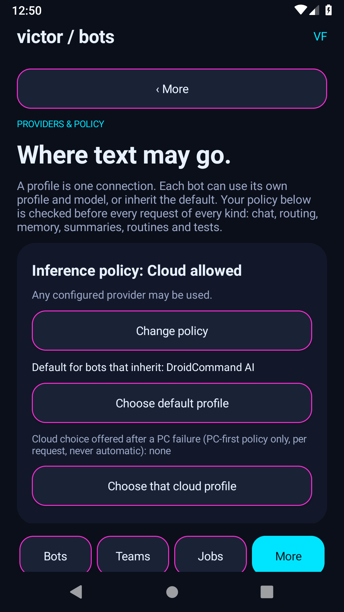

<div align="center">



# VictorBots

**Your AI crew. In your pocket.** An independent Android workspace for specialised AI bots.

Works on its own; fleet integration (droidcommand-AI) is optional

<p>
  
  <a href="https://github.com/Victorious93/VictorBots/actions/workflows/android.yml"></a>
  
  <a href="https://victorious-framework.pages.dev"></a>
</p>

</div>

Version **0.2.0** is a **development build** for Android 9 (API 28)+. No root. Native Java, SQLite, Android Keystore, HTTPS. No third-party runtime libraries.

VictorBots owns bot profiles, conversations, team coordination, memory controls and result presentation. [DroidCommand AI](https://github.com/Victorious93/droidcommand-AI) owns Android device execution and its permission boundary. A PC (the optional **PC runner** in `pc-runner/`) can own heavy inference and development work.

> Read **[MANUAL.md](MANUAL.md)** for setup, security, backup and troubleshooting. Read **[VERIFICATION.md](VERIFICATION.md)** for exactly what was and was not tested. Anything not listed there as verified is not claimed.

## Features

| Area | Behaviour |
|---|---|
| **Providers** | Several named profiles: cloud (OpenAI-compatible HTTPS) and PC (authenticated HTTPS). Each bot inherits the default or picks its own profile **and** model. Model discovery when the server supports it; manual id otherwise. Keys are encrypted with Android Keystore and cryptographically bound to *profile + endpoint origin*: editing an endpoint can never send the old key to a new host. |
| **Policy** | Owner policy (`Cloud allowed` / `PC first, cloud only if I confirm` / `PC only`; `This device only` is shown but unavailable). Enforced in **one place** (`Gateway`) for every kind of request: chat, routing, memory suggestions, summaries, routines, team turns, diagnostics, fallback. A bot can only make policy *stricter*. Background work never falls back to cloud. |
| **Diagnostics** | Five separate states: configuration saved · host reachable · credentials accepted · model available · **real reply received**. Owner-initiated live test names the destination and possible cost. Categorised errors (timeout, TLS, auth, model unavailable, malformed, unsupported). Requested vs server-reported model, tokens in/out (`unknown` when not reported), latency, first-token time. Capabilities shown as *configured / advertised / tested*. |
| **Context** | Token-aware budget per profile (your configured window; chars-per-token learned from the server's own reported usage). Reply space reserved; omitted turns counted and shown. Instructions and your message are never silently clipped: if they cannot fit, nothing is sent. |
| **Memory** | Per bot, editable, searchable (SQLite FTS4), deletable, with provenance. Optional project-shared memory (off by default). Suggestions are inert until you accept them and are produced only through the policy gateway. |
| **Teams** | Group chats with @mentions, mute, reply modes (mentions only / Chief of Staff routing / all / developer→QA review). Every round is capped by turns, tokens, time and hand-off depth, has a Stop button, suppresses duplicate answers, survives rotation and process death. Bot messages are untrusted text: they cannot change policy, grant anything or start work. |
| **Jobs** | Persistent records with correlation ids, states reported by the backend (queued / running / awaiting approval / completed / failed / cancelled), redacted bounded logs, artifacts with SHA-256 verification, safe previews. **Completion only ever comes from a backend report.** Uncertain sends become *outcome unknown* and are never repeated automatically. |
| **PC runner** | Small authenticated HTTPS service (`pc-runner/`, Python stdlib): explicit workspaces, owner-defined commands only, approvals with expiry, cancellation, per-workspace write lock (or git-worktree isolation), routines, inference pass-through, optional read-only MCP bridge. |
| **DroidCommand** | Text chat via `COMPANION_ASSIST` (unchanged). Execution via the **new separate `COMPANION_EXEC` contract** implemented in the droidcommand-AI repo (branch `feature/companion-exec-contract`). VictorBots has no approve button of its own. |
| **Skills & files** | Four bundled workflows (repo review, APK crash diagnosis, release prep, project plan) plus your own, with versions and declared needs; a skill is only text and grants nothing. Attach text/source/logs/images through the document picker with size/type limits; unsupported formats (PDF, Office, archives) are refused with a reason. File content is quoted as untrusted data. |
| **Backup** | Versioned export (v2); restore with preview, conflict handling (keep mine / add copies), validation, one transaction, integrity check. Never exports keys, avatars, logs or policy. Reads 0.1.0 (v1) backups. |
| **Routines** | Opt-in, created switched off. PC routines run on the PC runner's clock (continue when the phone is offline). Phone routines use Android's inexact JobScheduler (≈15 min at best) and the same policy. A run is *succeeded* only after its work finished. |
| **Connectors** | Read-only repository access through MCP servers *your PC runner is configured to expose*, enabled per bot, revocable. VictorBots installs nothing. |

## Screenshots

<p align="center">
  
  
  
  
  
  
</p>

Real captures of the 0.2.0 debug build (built with `scripts/build-sdk.sh`, fresh install) on an Android 9 (API 28) emulator, not a physical device. They show the empty first-run state: the default starter bots, no conversations or jobs, and no provider configured, so no model replies appear.

## Install / download

Development build, not finished software and not a production release. Install it only if you understand the risk.

- **GitHub Releases:** there are none yet, so there is no release APK to link.
- **CI artifact:** every run of the [Android CI workflow](https://github.com/Victorious93/VictorBots/actions/workflows/android.yml) uploads `VictorBots-0.2.0-debug.apk` as the `VictorBots-debug-apk` artifact. GitHub requires you to be signed in to download artifacts, and they expire.
- **Or build it yourself:** see [Build from source](#build-from-source).

The APK is signed with the bundled **public development key**; it is *not* a production release.

1. Install `VictorBots-0.2.0-debug.apk` on Android 9+.
2. More → Providers: add a cloud provider and/or your PC (see [MANUAL.md](MANUAL.md) §2–3).
3. Bots → open one, or edit it to choose its provider/model/policy.

Upgrading from 0.1.0 keeps all bots, chats and tasks (database migration v1→v2) and moves your single provider key into a profile bound to its endpoint. The same signing key is used, so Android updates it in place.

### Signing and DroidCommand pin

`signing/victorbots-debug.jks` is a public, development-only key (alias `androiddebugkey`, password `android`). Use a private release key for production and re-pair with DroidCommand after changing the signer.

- VictorBots debug signer SHA-256: `23:CE:FC:35:FA:9B:8C:E1:F5:D3:CC:E7:B1:89:AA:34:0F:F6:50:51:83:4C:C8:99:6E:AD:A0:8D:6A:0F:5B:82`
- DroidCommand debug signer pin (`DcaBridge.DEBUG_PIN`, the default trusted certificate SHA-256 for DroidCommand AI): `88:00:51:A6:D9:5D:38:DD:8D:81:E1:93:1E:17:05:48:03:87:D5:93:C3:09:43:53:99:68:E6:EF:11:A0:C8:4D`

## Build from source

Prerequisites: JDK 17+ (tested with 21), Python 3, Android SDK `platforms;android-35` and `build-tools;35.0.0`.

```bash
export ANDROID_HOME=/path/to/android-sdk
bash scripts/build-sdk.sh                 # -> app/build/sdk/VictorBots-0.2.0-debug.apk
bash scripts/test-jvm.sh                  # pure-Java suites on real SQLite + real TLS (fetches pinned test jars)
(cd pc-runner && python3 -I test_runner.py)   # runner tests (set VB_REAL_MCP=1 for the real-MCP live check)
bash scripts/build-test-sdk.sh            # instrumentation APK
adb install -r app/build/sdk/VictorBots-0.2.0-debug.apk && adb install -r build/instrumentation/tests.apk
adb shell am instrument -w com.victorious.bots.test/com.victorious.bots.test.SmokeInstrumentation
```

`./gradlew :app:assembleDebug` also exists. It could not be resolved in the original build environments; CI now runs it as a non-blocking job (it passed on `main` at commit `ceeb08c`). The SDK script is the supported path.

⚠ Run the instrumentation tests only on an **isolated emulator**: they create and delete their own fixtures in the app database.

## Manual

How-to: [MANUAL.md](MANUAL.md) (setup, security, backup and troubleshooting). What was and was not tested: [VERIFICATION.md](VERIFICATION.md).

## License

No licence file is present and no redistribution licence has been chosen for the app source created for Victorious Framework. The Gradle wrapper retains its upstream notices.

## Credits

Design ideas were studied from MIT-licensed OnlyTerp/opengrok and Z4YT0N/OpenGrokBot; no code was copied or installed (see [NOTICE.md](NOTICE.md)). Upstream names remain their owners'.
